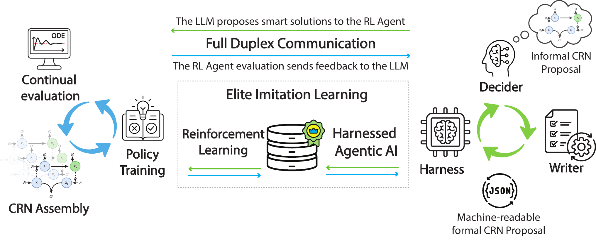

# FullDuplexCRNSearch

Full-duplex communication between language models and hybrid numerical search for **input–output chemical reaction network design**.

This repository accompanies *Full-Duplex Communication between Language Models and Hybrid Search for Scientific Discovery: A Biomolecular Network Design Application*. It contains the search implementation, task definitions, LLM integration, and tools for reproducing the analyses.



*Figure 1 from the paper. [Vector PDF](docs/assets/full_duplex_architecture.pdf) · [Vector SVG](docs/assets/full_duplex_architecture.svg).*

The system combines:

- **Structural reinforcement learning:** a policy constructs networks from a reaction library.
- **Numerical refinement:** genetic search explores structures and rates, while AdaGrad refines rates through differentiable simulation losses.
- **An agentic LLM:** a Decider develops proposals using scientific tools and feedback; a Writer produces machine-readable candidates for evaluation.
- **An archive and Elite Imitation Learning (EIL):** evaluated designs inform policy learning, while search results provide context to the LLM. The two processes run asynchronously.

The experiments cover robust perfect adaptation (RPA), Boolean logic, dose response, ultrasensitivity, biphasic responses, classification, and four-input parity. Communication, imitation, prompt, and model ablations examine how the components affect search and the discovered designs.

## Choose a workflow

| Goal | Start here | Requirements |
|---|---|---|
| Rebuild analyses and figures from recorded experiments | [Reproduce the results](#reproduce-the-results) | Compact data release, Python 3.10; no LLM or GPU |
| Run a new experiment using saved settings | [Run a new search](#run-a-new-search) | Data release, full Python environment, Julia, configured LLM harness |
| Develop the search implementation or define a new task | [Install the source code](#install-the-source-code) | Source repository and numerical dependencies |

## Install the source code

Download or clone this repository and run the following commands from its root. The numerical workflow was used on **Linux with Python 3.10**. The Python import package is named `RL4CRN`.

```bash
python3.10 -m venv .venv
source .venv/bin/activate
python -m pip install --upgrade pip
python -m pip install -e .
python -c 'import RL4CRN; print("Python package installed")'
```

On Debian/Ubuntu, system prerequisites can be installed with:

```bash
sudo apt-get update
sudo apt-get install build-essential python3-venv curl tar xz-utils bubblewrap
```

Ensure that the `venv` package matches your Python version. Julia is needed for AdaGrad parameter fitting; its environment is included in the compact release. The [Julia setup helper](tools/setup_julia.py), used below, installs the required version and checks rate fitting. Local LLM inference requires a separately provisioned model server. Hosted LLM use does not require a local inference GPU.

### Configure the LLM harness

The installer downloads the pinned DeepSeek Harness and its dependencies, creates default profiles, and starts its configuration GUI:

```bash
bash tools/install_harness.sh \
  --prefix "$HOME/.local/share/fullduplex-crn" \
  --config-dir "$HOME/.config/fullduplex-crn-harness"
```

The default is **DeepSeek Flash v4 with high reasoning**. Enter an API key at the hidden prompt, or press Enter and configure it in the GUI at **http://127.0.0.1:3080**. Existing credentials and settings are preserved. The GUI runs in the foreground; stop it with Ctrl-C. To reopen it:

```bash
"$HOME/.local/share/fullduplex-crn/bin/harness-gui"
```

Load the installed runtime and check the setup from the repository root:

```bash
source .venv/bin/activate
source "$HOME/.local/share/fullduplex-crn/env.sh"
python tools/check_harness_setup.py --dsh-home "$DSH_HOME" --backend deepseek
```

This check is offline. Add `--live` to evaluate one Decider/Writer batch with the configured model; hosted requests incur API costs. Search runners start their own harness processes, so the GUI can remain closed.

For a remote machine, use `--no-open`; for unattended installation, use `--no-gui --skip-api-key`. See the [harness setup guide](tools/HARNESS_SETUP.md) for SSH forwarding, endpoint configuration, live checks, and troubleshooting. A separate [Apptainer deployment utility](https://anonymous.4open.science/r/llm-deploy-CB83/) supports local LLM inference. Connecting a local model requires its OpenAI-compatible endpoint and model identifier, as described in the setup guide.

## Reproduce the results

The **compact reproducibility release is separate from the source repository**. The current prepared archive is `fullduplex-reproducibility-20261014.tar` (approximately 22 GB), accompanied by a SHA-256 checksum. It has been verified locally; a public download location has not yet been assigned.

Use Linux x86_64 with Python 3.10 for the bundled offline wheels. Allow space for both the archive and its extracted contents, plus approximately 1 GB for the analysis environment and additional working space. Place the archive and checksum in the source repository root, then run:

```bash
sha256sum -c fullduplex-reproducibility-20261014.tar.sha256
tar -xf fullduplex-reproducibility-20261014.tar
python3.10 -m venv reproduce/.venv
bash reproduce/reproduce.sh all --data-root ./fullduplex-reproducibility-20261014
```

The command installs the bundled analysis dependencies, validates the exported records, recomputes the principal analyses, and rebuilds the figures. **No API credentials, model server, GPU, Julia, or internet connection are needed.** The command uses the analysis code in this checkout and the frozen inputs from the extracted release. The manuscript directory is not required. See the [reproduction guide](reproduce/README.md).

Individual stages are also available:

```bash
bash reproduce/reproduce.sh verify --data-root /path/to/release    # Check retained records, hashes, and counts
bash reproduce/reproduce.sh analyze --data-root /path/to/release   # Recompute scientific summaries
bash reproduce/reproduce.sh figures --data-root /path/to/release   # Rebuild the manuscript figures
```

Results appear under `reproduce/output/` (or the directory supplied with `--output`):

| Output | Contents |
|---|---|
| `verification.json` | Data integrity and record checks |
| `scientific_checks.json` | Recomputed analysis checks |
| `eil_statistics_recomputed.json` | Imitation-ablation statistics |
| `figure_report.json` | Figure reproduction checks |
| `figures/` | Rebuilt figures |

Installing `poppler-utils` provides `pdftoppm`, which additionally checks rendered figures against the supplied reference PDFs. The verified release contains **521 distinct source runs** across explicitly defined, sometimes overlapping cohorts. All 17 reference figures matched in the tested environment: 16 were regenerated and the supplied architecture diagram was copied.

The analyses cover convergence, qualifying topology counts, structural categories, RPA motif and balance screens, Logic reduction and perturbation results, parity outputs, and LLM token usage, estimated costs, and tool calls. The release retains available network/rate records, losses, and provenance, including non-qualifying designs. Large simulation caches, policy checkpoints, and full LLM conversations are omitted.

These commands reproduce the analysis of recorded experiments. They do not rerun searches or every perturbation simulation. See the release's `README.txt`, `COHORTS.txt`, and `manifest/figure_inputs.json` for data coverage and the mapping from figures to inputs. For another platform, install `reproduce/requirements-analysis.txt` into a suitable environment and use `python reproduce/reproduce.py all --data-root /path/to/release`; bundled wheels and exact rendering were tested on the platform above.

## Run a new search

The **[search experiment CLI](reproduce/SEARCH.md)** provides 19 named presets covering all seven application tasks, communication/imitation/prompt/model variants, and numerical baselines. It prepares exact reference sources and settings, runs one or twenty seeds with progress reporting, compacts completed diagnostics, and analyses the new results.

Configure your model in the Harness, then pass its `provider/model` identifier:

```bash
source .venv/bin/activate
python -m pip install -r reproduce/requirements-search.txt
source "$HOME/.local/share/fullduplex-crn/env.sh"
python reproduce/search.py list

python reproduce/search.py prepare \
  --experiment logic-full --seeds 1-20 --parallel-runs 8 \
  --data-root /path/to/release \
  --model deepseek-official/deepseek-v4-flash \
  --output "$HOME/fullduplex-logic"

# Install/check the exact Julia version and test AdaGrad (no model requests):
python tools/setup_julia.py --install-julia \
  --project "$HOME/fullduplex-logic/jobs/seed-01/source/numerical_runtime/SynthEvo"
source "$HOME/.local/share/fullduplex-julia/env.sh"
python reproduce/search.py check "$HOME/fullduplex-logic"
python reproduce/search.py run "$HOME/fullduplex-logic"
python reproduce/search.py status "$HOME/fullduplex-logic"
python reproduce/search.py analyze "$HOME/fullduplex-logic"
```

Preparation makes no model calls. `run` launches searches and uses the configured model for LLM experiments. The Harness owns API keys, endpoints and model settings. See the guide for a tiny numerical smoke test, worker allocation, interrupted attempts, storage policy, and RPA/Logic diagnostics.

### Low-level archived-run preparation

For a matched experiment, use a saved run's source snapshot, configuration, and prompts. The release can prepare **Flash RPA and Logic** runs in a new directory, verifying the restored scientific source hashes. Other campaign configurations remain available under `data/campaigns/`.

For example, from the source repository, prepare the full-duplex Logic experiment for seed 1:

```bash
reproduce/.venv/bin/python reproduce/reproduce.py prepare-run \
  --data-root /path/to/release \
  --run 79f9fb37019a38f9 \
  --output "$HOME/fullduplex-logic-seed1"
```

This only prepares files. Select other run IDs using the data release's `manifest/runs.json` and `manifest/cohorts.csv`. The generated `replay_config/` contains the task, search hyperparameters, fitting recipe, and reference manifest; `run.sh` uses the saved seed, prompts, worker allocation, and communication settings.

Install the full numerical environment in the prepared directory. With **Julia 1.12.6** on your `PATH`, instantiate the supplied Julia project:

```bash
cd "$HOME/fullduplex-logic-seed1"
python3.10 -m venv .venv
source .venv/bin/activate
python -m pip install --upgrade pip
python -m pip install -e .
julia --project=numerical_runtime/SynthEvo -e 'using Pkg; Pkg.instantiate()'
```

After configuring the harness above, check that its model matches `replay_config/reference_manifest.json`, then launch:

```bash
source "$HOME/.local/share/fullduplex-crn/env.sh"
export OMP_NUM_THREADS=1 OPENBLAS_NUM_THREADS=1 MKL_NUM_THREADS=1
bash run.sh
```

Outputs go to `new_run/`, which must not already exist. This is a full experiment and may consume substantial compute, storage, and API credit. Saved settings support a matched rerun; asynchronous execution and model-service behavior mean that identical seeds do not guarantee identical discoveries. The preparation workflow has been checked, but no new full campaign was launched to validate the release.

For custom experiments, start with the [stream runner](comparisons/search_exploration/run_harness_streams.py), the configurations under `comparisons/search_exploration/`, and the [parameter-optimization interface](RL4CRN/parameter_optimization/README.md). The release's frozen settings are the reference for reproducing a specific recorded campaign.

## Repository structure

| Path | Purpose |
|---|---|
| `RL4CRN/iocrns/` | Input–output CRN representations and simulation interfaces |
| `RL4CRN/agents/`, `policies/`, `environments/`, `rewards/` | Reinforcement-learning components and task objectives |
| `RL4CRN/search_exploration/` | Search configuration, archives, structural descriptors, and exploration logic |
| `RL4CRN/search_streams/` | Coordination of numerical search and LLM streams |
| `RL4CRN/llm/` | Prompts, harness integration, candidate validation, evaluation, and feedback |
| `RL4CRN/parameter_optimization/` | Julia interface for rate optimization |
| `comparisons/search_exploration/` | Campaign runners, configurations, ablations, and analysis programs |
| `comparisons/rpa_search/` | RPA task and numerical comparison utilities |
| `comparisons/llm_crn_generation/` | LLM candidate-generation utilities and harness documentation |
| `tools/` | Harness and Julia setup, checks, and runtime helpers |
| `reproduce/` | Current-paper analysis, figure reproduction, and diagnostic helpers |
| `tests/` | Implementation tests |
| `docs/assets/` | README architecture figure |

## License

The code is distributed under the [GNU General Public License v3.0](LICENSE).
